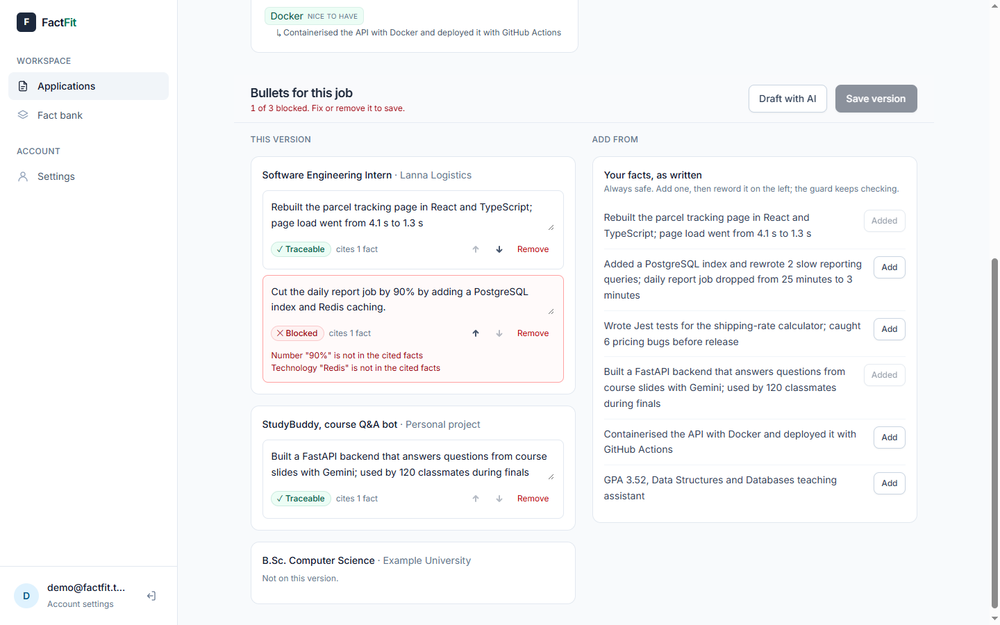
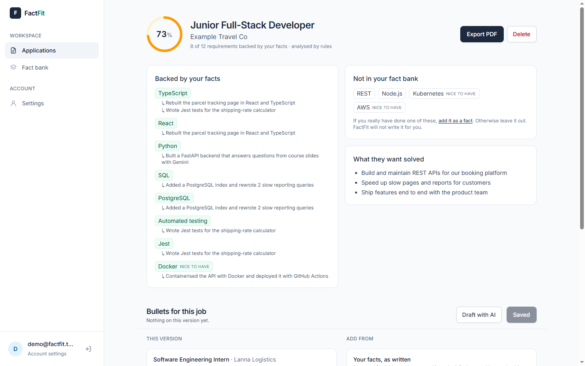
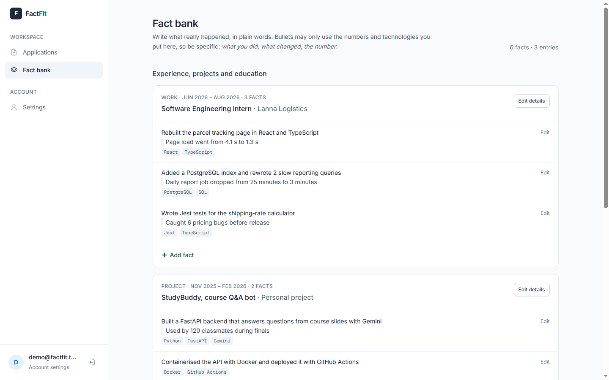
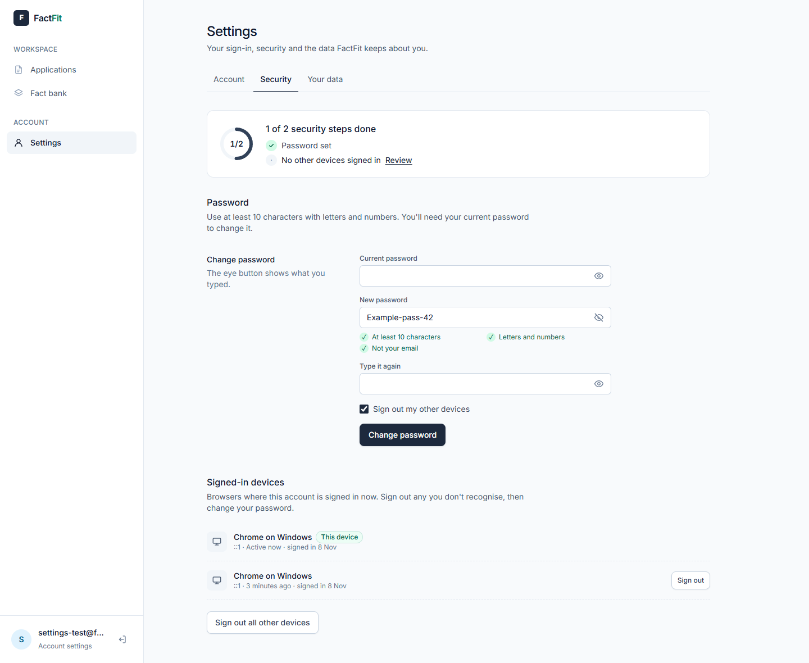
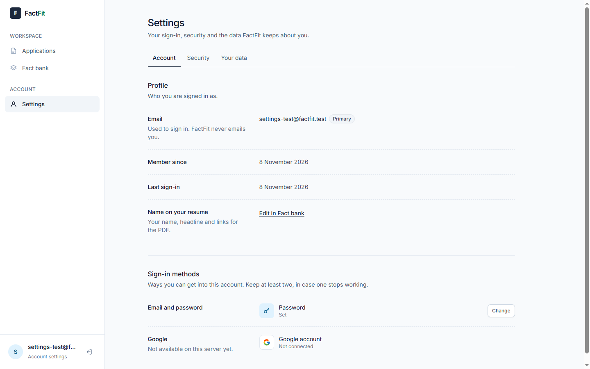
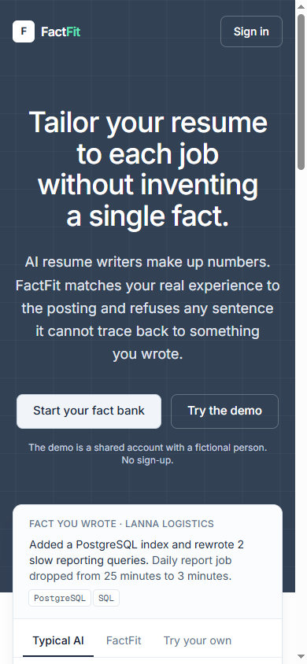
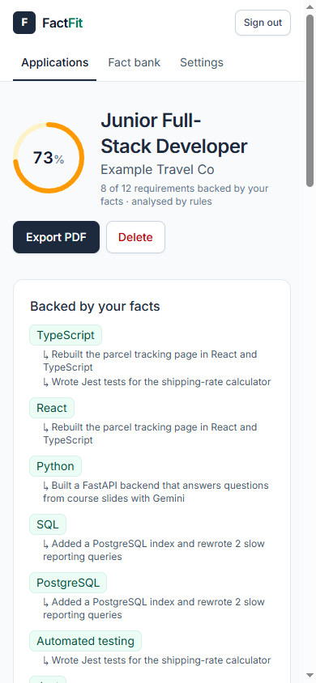

# FactFit

Tailor your resume to each job description without inventing a single fact.

AI resume writers happily make up numbers and tools. FactFit keeps a **fact bank** of what you actually did, maps a
job description against it, and only lets a bullet onto your resume if every number and every technology in it can be
traced back to a fact you wrote. That check is plain code, not a prompt.

**Live:** https://factfit-five.vercel.app · press **Try the demo account** to use a shared account with a fictional
fact bank, no sign-up needed.

| Landing page with the live guard demo | Bullet studio: one bullet traceable, one blocked |
|---|---|
|  |  |
| **Job mapping and fit score** | **Fact bank** |
|  |  |
| **Settings: security checklist, password with show/hide, signed-in devices** | **Settings: sign-in methods (email + Google)** |
|  |  |

<p>
  
  
</p>

Screenshots use the fictional demo account and are regenerated with `scripts/screenshots.mjs`.

## How it works

1. **Fact bank.** Per job, project or degree you write short facts: what you did, the result, the number, the tools.
2. **Paste a job description.** FactFit extracts the skills, keywords and problems (Gemini with a JSON schema, or a
   built-in rule-based extractor when no API key is set).
3. **Mapping and fit score.** Each requirement shows the facts that back it, or is listed as missing. The score is
   weighted (required ×3, nice-to-have ×1).
4. **Bullets.** Start from your facts as written or let the LLM draft XYZ-style bullets ("accomplished X, measured by
   Y, by doing Z"). Each draft cites fact ids. The **fabrication guard** blocks any bullet that
   - cites no fact, or a fact that does not exist,
   - contains a number not in the cited facts (units count: a fact's "30 ms" never backs "30%"; "doubled" needs evidence),
   - names a technology or tool-like term (`GraphQL`, `SQS`, `EC2`) not in the cited facts. A specific tool backs
     the broader practice ("Jest" backs "automated testing", "GitHub Actions" backs "CI/CD"), never the reverse.

   The guard runs live in the browser while you edit and again on the server when you save.
5. **Export.** A single-column, text-only A4 PDF (standard fonts, selectable text, a few KB) that ATS parsers read
   top to bottom.

## Eval

40 fictional cases (30 for tuning, 10 held out), details in [eval/README.md](eval/README.md):

- The guard blocked **100%** of 547 fabrications on the tuning set and **96.8%** of 186 on the held-out set,
  while accepting every faithful bullet (120 / 120). Its misses are same-number meaning swaps ("120 members" →
  "120 bookings").
- Gemini Flash-Lite drafted 113 bullets on 28 cases with **0** fabrications found by the guard, an independent
  bait check, or a manual spot check.
- A rewritten drafting prompt raised XYZ-style bullets from 31.6% to 75% (human-written: 86.7%) and cut
  copy-the-fact bullets from 66% to 6%, still with no fabrications.
- Gemini skill extraction recall on required skills: 82.8% (rule-based fallback: 70.5%).
- **Against a model that does make things up:** Typhoon 2.5 (via FreeLLMAPI) given a typical "make it impressive,
  add metrics" prompt wrote 26 bullets with invented or inflated numbers ("reduced rebuilds by 80%", "98% resolution
  rate within SLA"). The guard blocked **all 26**; the independent bait check found 3 leaks before the guard and
  **0** after. The cost: 10 of its 45 blocks were honest paraphrases it could not verify (410 KB → 260 KB written as
  "36%", "0.91" as "91%", "VMs" for "virtual machines").

**Account settings.** Sign in with email and password or with Google (when configured). Settings has three tabs:
*Account* (email, sign-in methods, connect or disconnect Google), *Security* (a checklist of real account facts,
changing the password after re-checking the current one, every password field with a show/hide button, the list of
signed-in devices with "sign out" per device or everywhere else) and *Your data*. The shared demo account can look
but not change any of it, and its device list is hidden because every visitor shares it.

Each job gets its own saved version. You can download everything as JSON or delete your account, which cascades to all
of your data.

## Stack

Next.js 16 (App Router, Server Actions) · TypeScript · Tailwind CSS 4 · Supabase Auth + Postgres · Drizzle ORM ·
Gemini behind a provider interface (`src/lib/llm/provider.ts`) · `@react-pdf/renderer` · Vitest · GitHub Actions.

```
src/lib/core/      pure logic, no I/O: vocabulary, guard, JD extraction, matching (unit tested)
src/lib/llm/       provider adapter + prompts with zod schemas
src/lib/data.ts    data access layer; every query is scoped to the signed-in user
src/lib/pdf/       resume PDF document
src/app/app/       authenticated app (fact bank, applications, settings)
src/proxy.ts       session refresh + optimistic redirect to /login
drizzle/           SQL migrations (RLS enabled, no public policies)
```

## Deployment

Vercel (region sin1) with a hosted Supabase project shared with two other apps of mine, so everything FactFit stores
lives in its own Postgres schema `factfit` (migration log included). Accounts are created server-side through the
Supabase admin API, so no confirmation emails or redirect URLs are configured on the shared project, and "Delete my
data" removes every FactFit row while leaving the shared sign-in alone. Gemini calls are capped per user per day
(and for the demo account as a whole) with Postgres-backed rate limits whose keys are HMAC hashes, never raw IPs or
emails. The runtime connects through Supabase's transaction pooler: the session pooler allows only 15 clients for
the whole project, and postgres.js stays reliable there as long as its pool is at least as large as the number of
queries run at once (it pipelines otherwise, which the pooler does not handle).

```bash
npx vercel@latest deploy --prod --yes                                               # deploy
DATABASE_URL=<session pooler url> npx drizzle-kit migrate                           # migrate the hosted schema
node --env-file=<prod env file> --import tsx scripts/seed-demo.mts --remote         # reset the hosted demo account
```

## Google sign-in

The code is in place (`googleSignInAction`, `linkGoogleAction`, `src/app/auth/callback/route.ts`); the button only
appears when `GOOGLE_AUTH_ENABLED=true`. To turn it on:

1. Google Cloud Console → APIs & Services → Credentials → *Create OAuth client ID* (Web application). Authorised
   redirect URI: `https://<project-ref>.supabase.co/auth/v1/callback` (locally `http://127.0.0.1:54321/auth/v1/callback`).
2. Supabase dashboard → Authentication → Sign In / Providers → Google: paste the client ID and secret, enable it.
   Same page: turn on *Allow manual linking* so "Connect Google" works in Settings.
3. Authentication → URL Configuration → Redirect URLs: add `https://factfit-five.vercel.app/**`.
4. Set `GOOGLE_AUTH_ENABLED=true` in Vercel (and in `.env.local` for local use, together with
   `SUPABASE_AUTH_EXTERNAL_GOOGLE_CLIENT_ID` / `_SECRET` and `enabled = true` under `[auth.external.google]` in
   `supabase/config.toml`).

The production Supabase project is shared with other apps, so enabling the provider there is a project-wide switch;
it only shows up where an app offers the button.

## Run locally

Needs Node 24+ and Docker Desktop.

```bash
npm install
npx supabase start          # local Postgres + Auth in Docker; prints the keys
cp .env.example .env.local  # fill in the publishable and secret keys it printed
npm run db:migrate
npm run seed:demo           # optional: a fictional demo account (credentials in scripts/seed-demo.mts)
npm run dev
```

Set `GEMINI_API_KEY` in `.env.local` to enable LLM job analysis and bullet drafting. Without it the rule-based
extractor is used and bullets come from your facts as written. `GEMINI_MODEL` is a comma-separated fallback chain
(default `gemini-flash-lite-latest,gemini-flash-latest`): overloads and rate limits are retried with backoff, and a
model that times out hands over to the next one.

For local dev and evals you can route through FreeLLMAPI, an
OpenAI-compatible router over free model tiers running at `http://127.0.0.1:31415/v1`: set `LLM_PROVIDER=freellmapi`,
`FREELLMAPI_KEY` (the unified key from its dashboard) and optionally `FREELLMAPI_MODEL` (default `auto`). It is never
used on Vercel, which cannot reach a local router.

```bash
npm test          # unit tests + offline eval
npm run test:live # calls the real Gemini API with .env.local (opt-in, never runs in CI)
npm run eval:live -- --provider freellmapi --model typhoon-2.5-30b-a3b-instruct   # other models, local only
npm run lint
npm run typecheck
```

## Roadmap

- [x] Scaffold, Supabase auth, fact bank schema and CRUD
- [x] JD extraction, mapping page, fit score
- [x] Bullet drafting with the fabrication guard, saved versions, PDF export, data export and account deletion
- [x] Eval set: 30 tuning + 10 held-out cases measuring guard catch rate, false blocks, keyword recall and bullet length
- [ ] Import facts from an existing resume (.docx / .pdf) for review
- [x] Deploy (Vercel + Supabase), demo account, daily AI limit
- [x] Screenshots in this README
- [x] Second LLM provider (OpenAI-compatible, FreeLLMAPI for local evals) and a stress test with a model that fabricates
- [ ] Guard: accept derived percentages and common abbreviations (the false blocks above)
